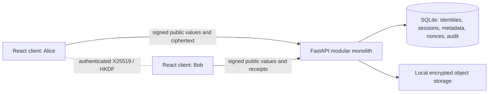
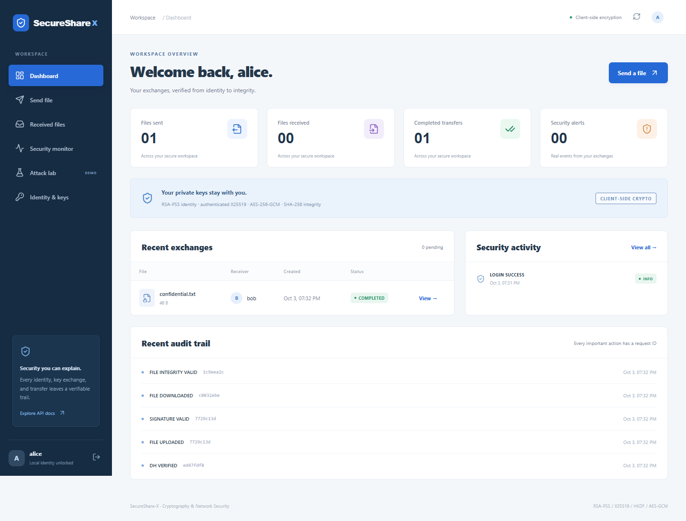
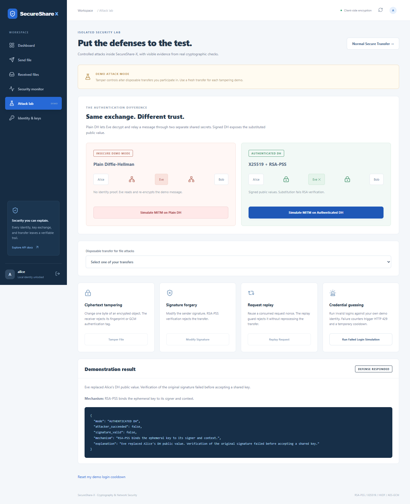

# SecureShare-X

**Secure file exchange with authenticated key exchange, hybrid cryptography, signed verification receipts, security monitoring, and an isolated attack lab.**

A Cryptography and Network Security mini-project for a three-member team. Alice and Bob prove their identities, exchange signed ephemeral X25519 public keys, derive an AES key locally, and exchange encrypted files. The server stores public metadata and ciphertext; private identity keys, shared secrets, AES keys, and plaintext stay on the clients.

The project makes each cryptographic step visible and demonstrates why encryption alone does not establish trust. The attack lab contrasts an actual plain-DH intercept-and-relay exchange with a signed-DH substitution rejected by RSA-PSS.

## Features

- Registration with client-generated RSA identities; Argon2id password hashing; password and one-use RSA challenge authentication; hashed opaque bearer tokens and logout.
- Both participants sign ephemeral X25519 values. A sender confirmation binds the full transcript before upload.
- HKDF-SHA256 derives a unique AES-256 key from the shared secret, transcript, and session identifier.
- AES-256-GCM encrypts files; SHA-256 fingerprints and RSA-PSS signatures bind file content and transfer context.
- Encrypted browser vaults, backup/import, and public key fingerprint pinning on first use.
- Validated transfer states, idempotent creation, persistent consumed nonces, timestamp windows, session expiry, upload bounds, safe filenames, and participant authorization.
- Atomic encrypted object writes with cleanup on failed database commits; retryable downloads and interrupted uploads.
- Structured JSON logs, request IDs, append-only application audit records, rule-based security events, statistics, and health checks.
- Responsive dashboard, send/inbox/details pages, identity management, security monitor, and six controlled attack demonstrations.
- Python unit/API/reliability tests, Web Crypto tests, real-process HTTP validation, browser end-to-end tests, and GitHub Actions.

## Architecture and workflow



The browser uses native Web Crypto. The Python cryptographic service verifies signatures and protocol parameters; it does **not** derive real transfer secrets or decrypt real files. `COMPLETED` means the server verified Bob's signed receipt claiming successful local decryption and fingerprint verification. A malicious recipient can lie about its own receipt; the server has no plaintext oracle.

See [architecture](docs/ARCHITECTURE.md), [cryptography and exact wire format](docs/CRYPTOGRAPHY.md), [threat model](docs/THREAT_MODEL.md), [system design](docs/SYSTEM_DESIGN.md), [API](docs/API.md), and [live demo guide](docs/DEMO_GUIDE.md).

## Stack and repository

Python 3.11+ (validated on Python 3.12), FastAPI, SQLAlchemy, Pydantic Settings, `cryptography`, Argon2, SQLite, React 19, Vite, native Web Crypto, pytest, Vitest, and Playwright. Node 24 is recommended and used in CI.

```text
backend/
  app/
    api/v1/          auth, users, sessions, transfers, security, audit, demo routes
    core/            configuration, crypto primitives, states, errors, logging
    db/              engine and declarative base
    models/          SQLAlchemy models
    schemas/         strict protocol/input schemas
    repositories/    authorized database lookups
    middleware/      request IDs, body limits, rate limiting
    services/        authentication, users, crypto, sessions, transfers, storage,
                     attack demos, security events, audit
  tests/             unit, API, security, reliability coverage
  storage/           encrypted runtime objects (ignored)
frontend/
  src/components/    badges, tables, lifecycle visualization
  src/pages/         authentication, dashboard, send, inbox, details, lab, security, keys
  src/services/      HTTP client, local vault, complete cryptographic workflow
  src/utils/         Web Crypto implementation and tests
  tests/             browser workflows
docs/                design, API, demo, validation, screenshots, sample file
scripts/             schema init, demo users/reset, real HTTP validation
.github/workflows/   automated validation
docker-compose.yml   optional local deployment
Project Guide.md     original implementation brief
```

## Local setup (Windows PowerShell)

Clone, create the virtual environment, and install the backend from the repository root:

```powershell
git clone https://github.com/JustATalentedGuy/SecurityMiniProject.git
cd SecurityMiniProject
py -3.12 -m venv .venv
.\.venv\Scripts\python.exe -m pip install -r backend\requirements-dev.txt
Copy-Item backend\.env.example backend\.env
```

Start the backend in the first terminal:

```powershell
cd backend
..\.venv\Scripts\python.exe -m uvicorn app.main:app --host 127.0.0.1 --port 8000 --no-access-log
```

Startup creates schema v1 and the encrypted storage directory. Optional explicit initialization, also from `backend/`:

```powershell
..\.venv\Scripts\python.exe ..\scripts\init_db.py
```

Start the frontend in a second terminal, from the repository root:

```powershell
cd frontend
npm ci
npm run dev
```

Open **http://127.0.0.1:5173**. API documentation is at **http://127.0.0.1:8000/docs**; health is at **http://127.0.0.1:8000/health**. Use one consistent frontend hostname: `localhost` and `127.0.0.1` have separate browser vault storage.

On Linux/macOS, use `python3.12 -m venv .venv`, `.venv/bin/python` from the root, and `../.venv/bin/python` from `backend/`. Copy the environment with `cp backend/.env.example backend/.env`. All Python scripts and tests otherwise work the same.

If an older npm installation fails with `Cannot read properties of null (reading 'edgesOut')`, use `npx --yes npm@latest ci`. This is a package-manager issue; the checked-in lockfile supports a clean install.

## Demo users and key creation

With the backend running, execute from the repository root:

```powershell
.\.venv\Scripts\python.exe scripts\create_demo_users.py
```

Choose a password when prompted. The script registers **alice**, **bob**, and **eve**, and writes their encrypted local vaults to ignored `demo-clients/`. It uploads only public keys. Re-running with the same password and vault directory preserves matching identities. Automation may provide the password through the `DEMO_PASSWORD` environment variable; never put it in a committed file or shell command argument.

Import `alice.vault.json` or `bob.vault.json` on the browser login page, and unlock with the chosen password. Alternatively use **Register** in the browser to generate a new RSA-3072 identity. The **Identity & keys** page downloads an encrypted backup; save a new backup after key exchanges so it includes their ephemeral keys.

Use separate browser profiles or an incognito window for simultaneous Alice/Bob sessions. Reloading the app locks the in-memory vault and requires sign-in again. The vault is locally encrypted; its password must remain available to its owner.

## Normal secure-transfer demo

1. Sign in as Alice and Bob in separate windows. RSA challenge login is available as a checkbox.
2. Alice opens **Send file**, chooses Bob and `docs/samples/confidential.txt`, then starts the exchange.
3. Bob opens **Received files**, opens that transfer, and selects **Accept key exchange**. Bob verifies Alice's RSA signature and signs his own ephemeral public value.
4. Alice opens the transfer, verifies Bob's response, and selects **Encrypt & upload**. If the file selection was lost after reloading, reselect the original file. The client confirms the signed transcript, derives its AES key, fingerprints/encrypts/signs, and uploads ciphertext.
5. Bob selects **Verify & download**. The client verifies both exchange signatures and the confirmation, verifies the file signature, checks ciphertext, decrypts with AES-GCM, and compares plaintext SHA-256 before downloading.
6. The lifecycle reaches **COMPLETED** after Bob's signed receipt. Inspect the fingerprints, request IDs, audit trail, and security monitor. The plaintext must exactly match the original.

The sender and receiver must be present during the exchange. Finish an uncompleted transfer before its default 30-minute session expiry. Verified downloads can be repeated while the required local keys remain available.

## Attack demonstrations

Open **Attack lab**. Each control explains the attempted attack and responding mechanism.

| Control | Setup | Expected result |
|---|---|---|
| Tamper File | Fresh AVAILABLE transfer; next verify/download as Bob | Ciphertext hash or GCM rejection; HIGH `FILE_TAMPERING_DETECTED` |
| Modify Signature | Another fresh AVAILABLE transfer | RSA-PSS rejection; HIGH `SIGNATURE_INVALID` |
| Replay Request | Any transfer with an already consumed signed operation | HTTP 409 `REPLAY_ATTACK_DETECTED`; HIGH `REPLAY_ATTACK` |
| MITM on Plain DH | No file required | Eve actually decrypts and re-encrypts an isolated demo message |
| MITM on Authenticated DH | No file required | Substituted public value fails RSA-PSS; CRITICAL `MITM_DETECTED` |
| Failed Login Simulation | Current authenticated demo identity | Real failed-password attempts lead to HTTP 429 and temporary cooldown |

The reset-cooldown button only resets the current demo identity. Completed/failed transfers cannot be corrupted by the lab. Set `ENABLE_ATTACK_DEMOS=false` in `backend/.env` and restart the backend to remove all `/api/v1/demo/*` routes and hide lab controls. See [DEMO_GUIDE.md](docs/DEMO_GUIDE.md) for detailed viva steps.

To reset **disposable local demo data**, stop the backend, run from `backend/`, then restart and re-register:

```powershell
..\.venv\Scripts\python.exe ..\scripts\reset_demo.py --confirm DELETE_DEMO_DATA
```

This explicitly deletes the configured development/test SQLite records and encrypted objects. It is restricted to demo-enabled development/test settings. Existing client vaults can be reused; remove stale exchange records from use by creating new transfers.

## Configuration

The backend reads `.env` relative to its working directory, so launch it from `backend/`. Defaults and all supported environment values are in [backend/.env.example](backend/.env.example). Environment variables override the file.

| Setting | Default | Purpose |
|---|---:|---|
| `MAX_UPLOAD_MB` | 25 | Plaintext size cap; ciphertext includes a 16-byte tag |
| `SESSION_EXPIRY_MINUTES` | 30 | Pending/uncompleted exchange lifetime |
| `REPLAY_WINDOW_SECONDS` | 300 | Signed request timestamps, past or future |
| `RATE_LIMIT_LOGIN` | 12 | IP login requests per sliding window |
| `RATE_LIMIT_UPLOAD` | 20 | IP transfer-create/upload requests per window |
| `RATE_LIMIT_VERIFICATION` | 60 | IP expensive verification operations per window |
| `LOGIN_FAILURE_THRESHOLD` | 5 | Failed attempts in a window before account cooldown |
| `LOGIN_LOCK_SECONDS` | 60 | Temporary account cooldown |
| `TOKEN_EXPIRY_MINUTES` | 120 | Hashed opaque authentication token lifetime |
| `CHALLENGE_EXPIRY_SECONDS` | 120 | One-use authentication challenge lifetime |
| `ENABLE_ATTACK_DEMOS` | true | Registers isolated lab endpoints |

Storage and database paths are configurable. SQLite schema initialization is non-destructive (`create_all`); changing a deployed schema requires a migration rather than assuming initialization will alter tables.

## Testing and validation

From the repository root:

```powershell
cd backend
..\.venv\Scripts\python.exe -m pytest -q --cov=app --cov-report=term-missing
..\.venv\Scripts\ruff.exe check app tests
cd ..
.\.venv\Scripts\python.exe scripts\validate_end_to_end.py
cd frontend
npm test
npm run build
npm run format:check
npm audit
npx playwright install chromium
npm run test:e2e
```

Playwright starts isolated API/frontend servers on **8010/5180**. The HTTP validator uses **8011**. They do not modify the normal development database or users. Browser screenshots are written under `docs/screenshots/`; failure traces/reports are ignored. The detailed, actual validation results and remaining environment limitations are in [VALIDATION.md](docs/VALIDATION.md).

To use an already installed Chrome instead of downloading Playwright Chromium, set `$env:SSX_BROWSER_CHANNEL = 'chrome'` before `npm run test:e2e` (or `SSX_BROWSER_CHANNEL=chrome npm run test:e2e` on Linux/macOS). Optional failure tracing is enabled only with `SSX_TEST_TRACE=1`; traces may contain disposable test credentials and must remain local/ignored.

GitHub Actions runs backend checks, actual HTTP validation, frontend checks/build/audit, and browser workflows. `SSX_TEST_PYTHON` can override the virtual-environment interpreter used by Playwright. `SSX_API_PROXY_TARGET` changes the Vite API proxy target.

## Screenshots

Captured from the actual browser workflow; regenerate with `npm run test:e2e`.





Additional captures: login, transfer lifecycle, real security events, and mobile dashboard in `docs/screenshots/`.

## Optional Docker startup

```powershell
docker compose up --build
```

Open **http://127.0.0.1:8080**. A named volume persists ciphertext and SQLite data. Local native setup is fully supported. Container execution requires a running Docker engine; see the validation report for what was actually exercised. Use `ENABLE_ATTACK_DEMOS=false` in the Compose environment for a demo-disabled run. A public deployment needs HTTPS; this configuration binds ports to localhost for the lab.

## Assumptions, limitations, and future work

- This is an educational protocol and implementation, not an independently audited production product. The server and delivered browser code are trusted for identity discovery. Verify fingerprints out of band; first-use pinning cannot authenticate a malicious first registry response.
- Use HTTPS beyond localhost. Web Crypto requires a secure context; bearer tokens and account passwords also need transport encryption.
- Encryption/decryption and upload handling are size-bounded in memory. They target files up to 25 MB rather than streaming multi-gigabyte files.
- Browser compromise/XSS or a malicious delivered client can access unlocked secrets. The local encrypted vault is protected while locked, but weak vault passwords permit offline guessing. Losing vault/password/session backups loses file access.
- Persisted client exchange keys make old file downloads possible. That retention weakens long-term forward secrecy compared with deleting ephemeral keys immediately after a one-time exchange.
- Metadata (identities, filenames, sizes, hashes, timing) is visible to the server. SHA-256 fingerprints can reveal equality or permit guessing predictable file content.
- SQLite and an in-memory per-IP limiter are intended for one application process. Same-IP lab users share request quotas. Audit records resist application edits, not database administrator tampering. A power loss can leave an unreferenced ciphertext object despite normal-failure compensation.
- Transfer lists show the latest 200 per direction, event/audit lists default to 100 (maximum 500). This is a bounded lab UI, not a large archival browser.
- Future production evolution: TLS/reverse proxy, verified key distribution, PostgreSQL migrations and row locking, Redis limits/token revocation, S3/MinIO storage, background jobs, key lifecycle and retention policies, audit integrity anchoring, recovery UX, large-file streaming, and independent security review. These infrastructure components are documented, not implemented.

## Three-member team division

| Member | Responsibility |
|---|---|
| 1 — Authentication & Identity | RSA keys, password/challenge authentication, signatures, identity verification, encrypted vaults |
| 2 — Secure Transfer & Cryptography | X25519, authenticated exchange, HKDF, AES-GCM, SHA-256, browser encryption/decryption |
| 3 — Backend, Design & Monitoring | FastAPI, database, states, storage, rate limits, idempotency, audit, detection, attack lab, frontend integration |

All three members should explain the complete workflow, including trust boundaries, nonce/IV differences, signed metadata, receipt semantics, and why unauthenticated DH is vulnerable.
