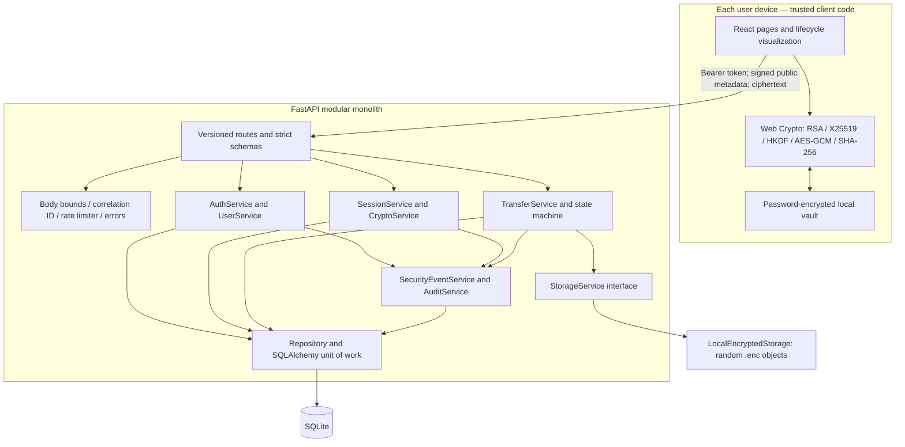

# Architecture

SecureShare-X is a modular monolith with a cryptographically active React client. The API coordinates public, signed key exchange messages; it never acts as either real user's DH endpoint.

## Components and boundaries



| Layer | Responsibility | Must not do |
|---|---|---|
| Routes | Parse protocol requests, inject services, format HTTP responses | Generate real client private/session keys |
| Schemas | Forbid extra fields, bound strings, validate UUIDs/hashes/integer timestamps | Accept secrets as protocol input |
| Services | Enforce identity, state, signature, freshness, and transaction rules | Persist decrypted files |
| Repositories | Centralize scoped record lookups | Reveal a transfer to nonparticipants |
| Crypto | Use library primitives and a deterministic wire format | Invent a cipher/signature algorithm |
| Storage | Atomically write/read/delete bounded encrypted objects | Use user filenames as filesystem paths |
| Observation | Record sanitized rule-based events and audit operations | Log passwords, keys, plaintext, or request bodies |
| Browser | Generate/retain keys, verify peers, encrypt/decrypt, sign receipts | Upload private keys or shared secrets |

The live attack lab deliberately creates **transient isolated demonstration keys** on the server for its synthetic DH comparison. These keys do not represent registered identities, do not process real files, and are neither persisted nor returned.

## Secure transfer sequence

```mermaid
sequenceDiagram
  participant A as Alice browser
  participant S as API / encrypted storage
  participant B as Bob browser
  A->>S: Create transfer + Idempotency-Key
  A->>S: RSA-signed X25519 initiation
  B->>S: Fetch signed initiation
  B->>B: Verify Alice RSA identity and context
  B->>S: RSA-signed X25519 response
  A->>S: Fetch signed response
  A->>A: Verify Bob signature; derive shared secret / HKDF
  A->>S: Signed transcript confirmation
  A->>A: SHA-256 plaintext; AES-GCM encryption; RSA signature
  A->>S: Ciphertext + signed metadata (no plaintext)
  S->>S: Verify signature, replay guard, signed context, ciphertext hash
  B->>S: Request ciphertext
  B->>B: Verify exchange and file signatures
  B->>B: X25519 / HKDF; decrypt; SHA-256 comparison
  B->>S: RSA-signed VERIFIED or failure receipt
  S->>S: Verify receipt and validated state transitions
  B->>B: Save verified plaintext download
```

## Persistence and lifetime

- The API stores password hashes, public keys, signed public DH messages, challenges, hashed tokens, transfer metadata, ciphertext references, nonce records, and observation data.
- Encrypted browser vaults live in localStorage and optionally in user-held `.vault.json` backups. PBKDF2-SHA256 and AES-GCM protect their private contents. The unencrypted envelope exposes the username/KDF parameters only.
- Unlocked vault contents and selected plaintext files stay in the browser's memory. Reload/sign-out locks the vault. Downloads become user-owned plaintext files outside the service.
- Ephemeral private exchange keys are retained **inside the encrypted client vault** to support later downloads; the server stores no matching secrets.
- `.env`, runtime databases/objects, token-bearing traces, generated demo vaults, and local environments are excluded from Git.

## Transaction boundaries

The database dependency commits successful routes and rolls back failures. Signature/context/freshness checks precede accepted state changes. Detection rejects persist their own audit/security evidence before raising an error. Unique constraints enforce username, transfer idempotency, session identity/one session per transfer, and per-user consumed nonces.

Upload finalization commits inside `TransferService` so a database failure can delete its new encrypted object and roll back metadata, nonce, history, and audit together. Storage first writes a temporary ciphertext file, flushes it, then atomically replaces the final object. Interrupted body reads never write an object. A machine crash in the narrow write/commit gap can leave an orphan ciphertext object; production would reconcile storage and metadata.

## Portability

SQLAlchemy models and repository boundaries permit PostgreSQL evolution, and the storage protocol permits an S3 implementation without changing transfer business logic. Current tests and runtime target SQLite, one worker, and local storage; a production migration needs schema migrations, row locking, shared rate limits, TLS, and external key verification. No distributed infrastructure is implemented.
