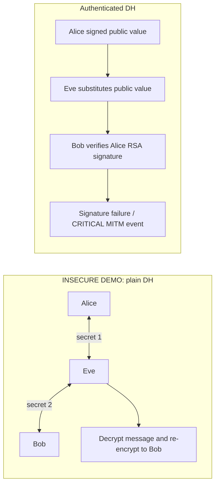

# Cryptography and protocol v1

## Primitives

| Purpose | Construction |
|---|---|
| Identity signatures | RSA-PSS, SHA-256, MGF1-SHA256, exactly 32-byte salt |
| Identity size | Browser/demo keys: 3072 bits; API accepts 2048–4096 bits and exponent 65537 |
| Ephemeral exchange | X25519, new pair per transfer; 32-byte public value, low-order values rejected |
| Session derivation | HKDF-SHA256, 32 bytes, transcript-specific salt/context |
| File encryption | AES-256-GCM, 12-byte secure random IV, 128-bit tag |
| Fingerprints | SHA-256, lowercase 64-character hex |
| Password storage | Argon2id, time cost 3, 64 MiB memory, parallelism 2 |
| Local vault | PBKDF2-SHA256, 600,000 iterations, random 16-byte salt, AES-256-GCM |
| Request nonces | 16 random bytes represented as 32 hex characters |
| Authentication tokens | Random opaque URL-safe values, only SHA-256 hash persisted |

All randomness comes from `secrets`/cryptographic key generation or browser `crypto.getRandomValues`. RSA is used for identity and signatures, not textbook RSA encryption. AES-ECB, MD5, SHA-1, manual ciphers, and truncating DH results are not used.

## Canonical signed data

All signed objects have `protocol: "secureshare-x/v1"` and a purpose tag. Serialize recursively with keys sorted lexicographically, compact separators, ASCII JSON escapes, UTF-8 encoding, and integer Unix timestamps. No floats are accepted in cryptographic metadata. UUIDs use their canonical string form. Base64 is standard padded RFC 4648, not base64url.

Python: `json.dumps(data, sort_keys=True, separators=(",", ":"), ensure_ascii=True).encode()`.

JavaScript: recursively sort object keys, `JSON.stringify`, then escape non-ASCII UTF-16 code units as `\uXXXX`. This also matches Python's surrogate pair encoding for emoji. The frontend's canonicalization tests verify the behavior.

Example:

```json
{"a":1,"z":"\u00e9\ud83d\ude00"}
```

Schemas reject unknown fields and missing/noncanonical protocol fields. Metadata is never reconstructed from ambiguous string concatenation. Every signature is over the canonical object bytes.

## Challenge-response authentication

The signed challenge object binds `protocol`, `purpose=login-challenge`, `challenge_id`, `user_id`, random `challenge`, and `expires_at`. Challenges expire after 120 seconds by default. A database conditional update consumes a still-unused, unexpired challenge atomically; reused or expired challenges cannot issue another token. Invalid signatures consume that challenge and add authentication failure evidence. Password and RSA modes share temporary account cooldown checks.

## Authenticated DH sequence

```mermaid
sequenceDiagram
  participant A as Alice
  participant API as Public exchange coordinator
  participant B as Bob
  A->>A: Generate ephemeral X25519 a/A
  A->>API: RSA signature over initiation and A
  API->>API: Verify Alice signature, timestamp, nonce, state
  B->>API: Fetch initiation and registered Alice public key
  B->>B: Verify signature and pinned identity fingerprint
  B->>B: Generate ephemeral X25519 b/B
  B->>API: RSA signature over response containing A and B
  API->>API: Verify Bob signature, original A, identity/context
  A->>API: Fetch signed response
  A->>A: Verify Bob signature and pinned fingerprint
  A->>API: Signed confirmation of full transcript hash
  A->>A: X25519(a, B) then HKDF
  B->>B: X25519(b, A) then HKDF
  Note over A,B: Identical AES-256 key; API never learns a, b, shared secret, or AES key
```

Initiation includes `purpose=dh-initiate`, transfer ID, session identifier, sender/receiver IDs, Alice public value, `receiver_ephemeral_public_key=null`, timestamp, and request nonce.

Response includes the same participants/transfer/session/Alice public value, `purpose=dh-respond`, Bob public value, its own timestamp, and a fresh request nonce. A signature cannot be transplanted to a different recipient or transfer.

Confirmation includes `purpose=dh-confirm`, transfer ID, session identifier, full transcript SHA-256, timestamp, and fresh request nonce. Both API and receiver verify the confirmation. This authenticates transcript acceptance; there is no separate encrypted key-possession confirmation message. The subsequent valid GCM ciphertext demonstrates the sender's derived key to the receiver.

## Exact key derivation

```text
transcript_bytes = canonical({"sender": sender_metadata,
                              "receiver": receiver_metadata})
transcript_sha256 = SHA256(transcript_bytes)       # hex for wire format
secret = X25519(local_private, peer_public)
salt = hex_decode(transcript_sha256)              # 32 bytes
info = UTF8("secureshare-x/v1/aes256gcm/" + session_identifier)
aes_key = HKDF-SHA256(secret, salt, info, length=32)
```

The transcript binds both signed public values, identities, purpose tags, transfer IDs, timestamps, and exchange nonces. HKDF context separation prevents accidentally reusing a key between independent sessions. Library X25519 rejects invalid all-zero/low-order exchanges.

## File package and AAD

Signed transfer metadata includes:

```text
protocol, purpose="file-transfer", transfer_id, session_identifier,
sender_id, receiver_id, filename (sanitized display name), mime_type, file_size,
plaintext_sha256, ciphertext_sha256, transcript_sha256, nonce, timestamp
```

Here `nonce` is the **GCM IV**, standard base64 encoding of 12 random bytes. Exchange and receipt nonces are independent 32-character hexadecimal values. Persistent `(user_id, nonce)` uniqueness also prevents reusing an upload IV by the same sender; every transfer has fresh DH material.

GCM additional authenticated data is the canonical transfer metadata **without `ciphertext_sha256`**. That hash cannot be available before encryption, so excluding it avoids a circular definition. All remaining metadata is authenticated by GCM. Once encryption produces `ciphertext || 16-byte tag`, compute the ciphertext hash, add it to the metadata, and RSA-sign the entire final object, including that hash.

Upload body contains only ciphertext plus the appended tag. The IV/signature/signed metadata are headers; the database stores them. No separate tag field is needed because Python AESGCM and Web Crypto both append the 16-byte tag.

Filename and MIME type are untrusted signed display metadata. They do not become paths, executable previews, or MIME truth assertions. SHA-256 alone is not an authentication mechanism; signatures and AES-GCM establish authenticated integrity.

## Receiver and signed receipt

The browser verifies the signed exchange, sender confirmation, file metadata signature, participant/transfer/session context, timestamp/session bounds, ciphertext fingerprint, GCM authentication tag, plaintext size, and plaintext SHA-256. It submits a fresh RSA-signed receipt binding `protocol`, `purpose=transfer-receipt`, transfer ID, receiver ID, result, plaintext hash (or null for failures), timestamp, and nonce.

A positive receipt is accepted only after a download. Negative local verification receipts can reject an available transfer before download (for example, a modified signature). Reusing a signed receipt is a replay. Only the receiver can submit either form. The server verifies the receipt and sender-declared hash, but cannot independently inspect decrypted content.

## Plain DH versus authenticated DH



The insecure demonstration performs actual encryption/decryption/relay on a harmless synthetic message. The authenticated demonstration alters a signed public value and runs the same RSA-PSS verification primitive as the real exchange. Neither control accepts external targets.

## Security limits

Authenticated DH prevents substitution only when the verification public key is authentic. Public keys come from a trusted server registry; browser first-use pins detect later changes, while out-of-band fingerprint checks address initial trust. A compromised server delivering hostile JavaScript can capture unlocked client secrets.

Retained encrypted ephemeral keys permit historical downloads; they reduce forward secrecy if an attacker later obtains and unlocks the whole vault. JS memory wiping is best-effort; garbage-collected runtimes can retain copies. Password login is optional identity convenience, but possession of private keys remains necessary to sign exchanges/files and decrypt.

Reference implementation guidance: [cryptography X25519](https://cryptography.io/en/latest/hazmat/primitives/asymmetric/x25519/), [authenticated encryption](https://cryptography.io/en/latest/hazmat/primitives/aead/), [Web Crypto deriveKey](https://developer.mozilla.org/en-US/docs/Web/API/SubtleCrypto/deriveKey), and [RFC 5869 HKDF](https://www.rfc-editor.org/rfc/rfc5869).
