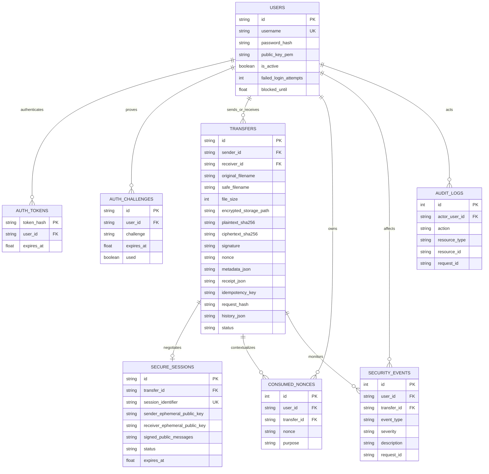
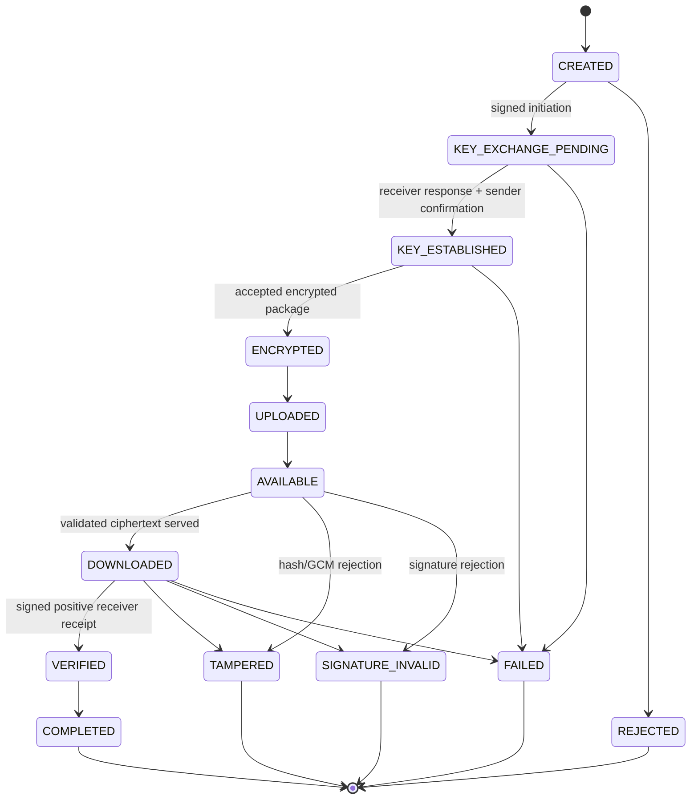
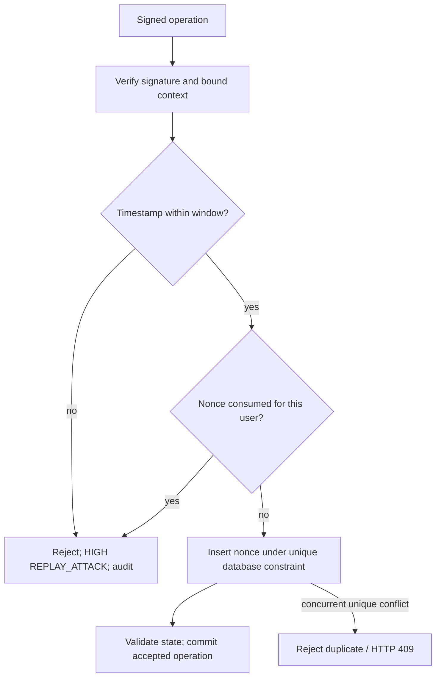
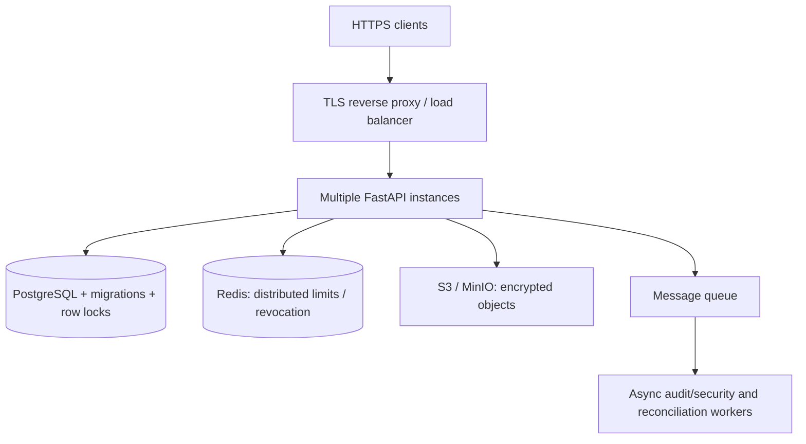

# System design

## Functional requirements

Register RSA public identities; authenticate by password or one-use signed challenge; discover recipient keys; perform two-party signed X25519 exchange; derive file keys locally; upload/download ciphertext; verify files locally and persist signed receipts; show validated lifecycle states; reject replay/tampering/unauthorized actions; show audit/security evidence; demonstrate six isolated attacks; initialize/reset disposable lab data.

## Non-functional requirements

Correct library cryptography, explicit trust boundaries, no server plaintext/private keys, bounded input/memory use, consistent state after routine failures, understandable errors, reproducible local setup, traceable operations, and a responsive usable demonstration interface. The deployment target is one process and small classroom datasets, with a configurable default 25 MB file limit. High availability and distributed workloads are future work.

## Architecture and API organization

The modular monolith separates routes, strict schemas, services, repositories, state/crypto logic, storage, and observation. FastAPI dependency injection provides a request-scoped SQLAlchemy session. Routes are versioned under `/api/v1/`; `/health` is a compatibility health endpoint. See [ARCHITECTURE.md](ARCHITECTURE.md) and [API.md](API.md).

Authentication tokens are random opaque bearer credentials. Their SHA-256 hashes and expiry are stored in `auth_tokens`; no signing secret or hardcoded JWT key is needed. Logout deletes the hash. Public identity keys are immutable through the current API; key rotation is future work. Registration hashes passwords with Argon2id.

## Database design

UUID string identifiers avoid guessing sequential resource IDs. Username, `(sender_id, idempotency_key)`, `session_identifier`, one `secure_sessions.transfer_id`, and `(user_id, nonce)` are unique. Foreign keys are enabled for SQLite. WAL mode and a 15-second busy timeout improve classroom concurrency. Database timestamps are Unix seconds; protocol timestamps are strict integers. Public transcripts/signatures and transfer histories are serialized JSON/Text, without secrets.

`Base.metadata.create_all` supplies schema v1 initialization on startup or via `scripts/init_db.py`. It does not migrate existing columns. The explicit disposable-data reset drops/recreates the lab schema and deletes recognized encrypted objects only when the demo flag, environment, SQLite URL, and confirmation argument permit it.

## Transfer and session state machines

The code's transition table is authoritative: each intermediate normal state permits only its next success state and terminal failure states. `VERIFIED` permits only `COMPLETED`; failures and `COMPLETED` cannot transition further. `REPLAY_REJECTED` is available as a terminal failure classification, but a replay request against a legitimate transfer is rejected/logged without destroying that transfer's existing successful state.

The server observes the ENCRYPTED/UPLOADED/AVAILABLE stages together only after receiving valid ciphertext; client progress shows actual prior encryption. The server does not falsely attest observing plaintext encryption or decryption. Session states are `PENDING`, `RESPONDED`, and `ESTABLISHED`; expiry is enforced when accepting exchange operations, upload, and uncompleted download.

Repeated DOWNLOAD requests in DOWNLOADED/COMPLETED safely return ciphertext without repeating verification transitions. A fresh positive receipt requires DOWNLOADED; a negative receipt can reject AVAILABLE before download. An expired uncompleted exchange needs a new transfer. A completed transfer can be re-downloaded with retained client keys.

## Security architecture

RSA-PSS signs domain-separated canonical messages. X25519 public keys are validated, both roles are bound to the transfer, and HKDF binds the complete signed transcript. AES-GCM authenticates file metadata through AAD; RSA also binds the final ciphertext hash. Each server mutation checks authenticated actor authorization, cryptographic metadata, timestamp/nonce freshness, and valid state. Receivers independently repeat cryptographic checks locally.

The initial registry is trusted, with client-side public-key fingerprint pins detecting subsequent changes. This design is not a certificate infrastructure and does not protect against malicious JavaScript delivered by a compromised host. See [THREAT_MODEL.md](THREAT_MODEL.md).

## Replay detection

Nonces persist across server restarts and are not prematurely pruned. Timestamp validation allows a configurable past/future window (default 300 seconds). Challenge replay protection additionally uses an atomic conditional consume. AES IVs are separately generated 96-bit values but also enter persistent nonce records at upload. Signature failure does not consume the upload nonce; routine storage failure rolls it back for retry.

## Idempotency

Dashboard counts use server-side aggregates across all transfers; recent tables remain bounded. Positive completion receipts also require an unexpired session. Atomic SQL increments preserve concurrent authentication failure counts before applying account cooldowns.

Transfer creation requires a UUID `Idempotency-Key`. The server hashes the canonical creation request and looks up the key scoped to the sender. Matching repeated payloads return the same transfer ID and current state; differing payloads return HTTP 409 `IDEMPOTENCY_CONFLICT`. A unique constraint and concurrent-conflict recovery prevent duplicate creation. Idempotency is distinct from replay: creation safely reuses a request, while signed nonces cannot execute a mutation twice.

## Rate limiting and failure counters

A thread-safe per-IP, per-category in-memory sliding window limits login, registration, challenge generation, expensive signature verification, transfer creation/uploads, and demo controls. Limits return HTTP 429 with `Retry-After` and a security/audit event. Stale limiter entries are evicted. Source IP comes from the connection rather than untrusted forwarded headers.

Per-account failure counters additionally track attempts in a configured window, generating `BRUTE_FORCE_DETECTED` and temporary cooldown. Successful authentication resets failure state. Demo brute force invokes real password verification against the current identity only; reset clears that user's cooldown. Production needs Redis/distributed limits and correctly configured trusted proxy/IP handling.

## Storage, limits, and reliability

`StorageService` defines `write/read/delete/healthy`; `LocalEncryptedStorage` is the implementation. Objects have random 32-hex-character names ending in `.enc`. Paths must match that shape and resolve directly inside the configured storage root. Filenames are sanitized for display/download and never determine storage paths.

Files are encrypted/decrypted in client memory, and ciphertext is read in bounded chunks before storage. The default plaintext limit is 25 MiB, with 16 bytes allowed for the GCM tag. JSON bodies are limited to 64 KiB. The middleware checks advertised length before reading; upload streams are independently bounded for missing/chunked lengths. This trades scalability for straightforward, correct AEAD use.

| Failure | Handling |
|---|---|
| Duplicate creation | Return same transfer, or reject mismatched idempotency payload |
| Replayed challenge/nonce | Reject and retain detection evidence; do not repeat the operation |
| Interrupted upload | No object/state finalization; sender can retry with valid metadata |
| Disk write failure | Roll back upload state/nonce/audit; return storage unavailable |
| Database commit failure after object write | Delete the new object and roll back metadata/history |
| Missing encrypted object | Controlled unavailable error; no plaintext returned |
| Expired session | Controlled SESSION_EXPIRED rejection; create new transfer |
| Wrong RSA signature | Reject and log HIGH signature or CRITICAL exchange/MITM evidence |
| Corrupted ciphertext | Reject before completion; record TAMPERED |
| Browser GCM/plaintext failure | Receiver signs a negative receipt; no plaintext download |
| Invalid transfer mutation | HTTP 409 and SUSPICIOUS_STATE_CHANGE |
| Crash between storage write and DB commit | Possible orphan encrypted object; documented reconciliation requirement |

SQLite provides a single writer, not distributed transaction coordination. The app's database/storage transaction compensation covers ordinary failures; there is no atomic distributed filesystem/database commit.

## Errors and observability

Errors have `error`, understandable `message`, and `request_id`; validation errors omit submitted sensitive fields and stack traces. Known conflicts, authentication failures, rate/size limits, unavailable resources, database failures, and disk failures receive appropriate status codes. Logs are structured JSON with event type, timestamp, severity, actor/transfer/source/request IDs, and status. Passwords, bodies, private/AES keys, and plaintext are never logged.

Audit and security records share the operation's correlation ID. Audit records are append-only through API design and ORM update/delete guards; a database administrator can still bypass the application. Rejection evidence is committed even when a request fails. Event/audit views are restricted to the actor and participant-owned transfer resources. Successful login is INFO, repeated failures MEDIUM, replay/signature/integrity failures HIGH, and authenticated-DH MITM CRITICAL.

Both health endpoints check application, database connectivity, and storage directory readability/writability; they return boolean component health without paths/credentials. They are liveness/readiness hints, not disk-quota or deep object-integrity monitors.

## Scalability and future production architecture (not implemented)

Before scaling: add TLS, reliable initial key verification, key rotation/recovery policy, storage quotas/retention, pagination/aggregate dashboards, PostgreSQL transactions/locks, Redis counters, object-store reconciliation, audit anchoring, background processing, and independent cryptographic review. Streaming AEAD for large files requires a deliberate authenticated framing protocol rather than naively splitting GCM ciphertext. No Redis, PostgreSQL server, S3, queue, Grafana, or Prometheus infrastructure is added to this mini-project.
